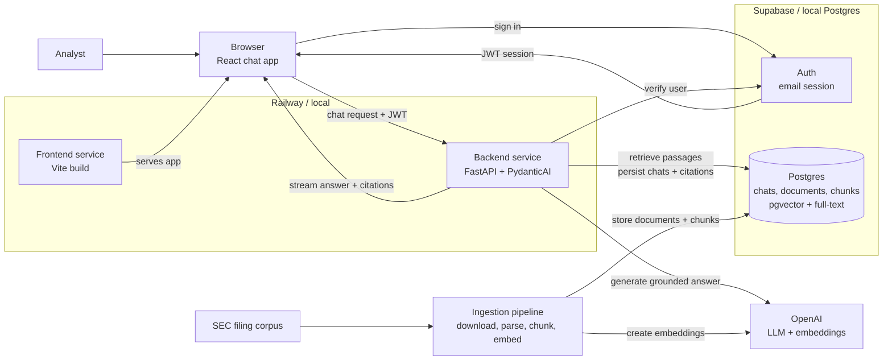

# Document Copilot Architecture

## Purpose

Document Copilot is an internal research assistant for analysts who need grounded answers from a curated SEC filing corpus. The architecture optimizes for trust: every answer is generated from retrieved source passages, every factual claim is citable, and the system fails clearly when the corpus does not support an answer.

## High-level architecture



## Architectural goals

- Keep the browser thin: it renders chat state, manages the user's session, and streams assistant responses.
- Keep the backend authoritative: retrieval, grounding, citation checks, tool execution, and database writes happen in FastAPI.
- Use Postgres for identity-backed durable state: users, chat threads, source documents, chunks, embeddings, and citation metadata.
- Use `pgvector` for semantic retrieval and Postgres full-text search for keyword retrieval; fuse with Reciprocal Rank Fusion.
- Make the LLM path typed and testable with a PydanticAI agent with explicit dependencies, outputs, and tool boundaries.
- Preserve a simple deployment model: one frontend service, one stateless backend service, one hosted Postgres.

## Request flow

1. The user signs in (Supabase email auth in real mode; local demo auth in demo mode).
2. The frontend stores the session and loads threads through FastAPI.
3. Opening a thread loads prior messages through FastAPI, which reads user-scoped rows.
4. The chat UI uses the Vercel AI SDK React primitives (`useChat`) to manage message state.
5. The frontend sends the bearer token with every request (`src/lib/http.ts`).
6. FastAPI verifies the token before doing any retrieval or LLM work (`app/auth/dependencies.py`).
7. A request-scoped context carries the authenticated user, thread, retriever, and status callbacks.
8. The agent retrieves relevant document chunks (tools register every passage in the turn registry — the citation allowlist), then produces a typed `GroundedAnswer`.
9. FastAPI streams assistant parts back to the browser in AI-SDK-compatible SSE (`text-start/delta/end`, `data-citation`, `data-status`).
10. FastAPI persists the user message, assistant message, citations, and usage metadata.

## Backend layout

```text
backend/app/
├── api/
│   ├── auth.py                 # session + demo-auth routes
│   └── chat.py                 # chat threads and streaming
├── auth/
│   └── dependencies.py         # JWT verification and current-user dependency
├── chat/
│   ├── orchestrator.py         # coordinates one chat turn end-to-end
│   ├── messages.py             # AI SDK messages ↔ chat_messages rows
│   └── streaming.py            # AI SDK-compatible SSE events
├── assistant/
│   ├── agent.py                # PydanticAI agent (real) / extractive agent (demo)
│   ├── demo_agent.py           # keyless demo agent
│   ├── deps.py                 # DocumentAgentDeps + TurnRegistry
│   ├── outputs.py              # GroundedAnswer, Citation
│   ├── status.py               # tool events → pipeline status
│   └── instructions.md         # system instructions and product contract
├── retrieval/
│   ├── queries.py              # pgvector + full-text SQL
│   ├── fusion.py               # Reciprocal Rank Fusion
│   ├── keywords.py             # keyword extraction for FTS
│   ├── embeddings.py           # query embedding
│   ├── retriever.py            # embed → search → fuse → hydrate
│   └── types.py                # RetrievedPassage, SearchFilters
├── grounding/
│   └── validator.py            # fail-closed citation validation
├── database/
│   ├── base.py, session.py     # SQLAlchemy wiring
│   ├── models/                 # users, threads, messages, citations, documents, chunks
│   ├── chats.py                # thread/message/citation persistence
│   ├── documents.py            # chunk + document lookups
│   └── users.py                # user provisioning
├── schemas/chat.py             # request/response models
└── main.py
```

## Retrieval strategy

Hybrid retrieval runs two bounded queries against `document_chunks`:

1. **Semantic** — `pgvector` cosine distance over the query embedding.
2. **Lexical** — Postgres full-text search (`ts_rank_cd` over a generated `tsvector`), with keywords distilled from the question (LLM-extracted in real mode, deterministic extraction in demo mode) because Postgres ANDs every word in a `plainto_tsquery`.

The two ranked lists are fused with **Reciprocal Rank Fusion** (`score += 1 / (60 + rank)`), the top-k chunk ids are hydrated with their source documents, and each hit is expanded with **neighboring chunks** (radius 1) so the agent sees context without extra tool calls.

## Grounding and citation policy

Grounding is part of the architecture, not a prompt preference:

- Every assistant answer has at least one citation unless it explicitly reports insufficient evidence.
- Every citation maps to a retrieved source passage (enforced by the turn registry).
- The model cannot cite documents that were not retrieved in the current turn.
- Excerpts must be verbatim substrings of the cited chunk.
- An LLM judge (real mode) or substring check (demo mode) verifies each citation's support. On failure the turn is retried once with stricter grounding, then a controlled failure message is returned instead of an unverified answer.

## Data model

- `users` — one row per authenticated user.
- `chat_threads` — thread metadata, owner, title, timestamps.
- `chat_messages` — user and assistant messages in order, with AI-SDK-compatible part JSON.
- `message_citations` — normalized citation records linked to assistant messages.
- `source_documents` — filings with ticker, form, dates, accession number, source URL, and extracted text.
- `document_chunks` — retrieval-ready passages: chunk text, section/page metadata, `vector(1536)` embedding, generated `tsvector`, token count, and JSON metadata.

Schema changes: update SQLAlchemy models → `alembic revision --autogenerate` → review (generated tsvectors, HNSW/GIN indexes, and the `vector` extension are written explicitly with `op.execute`) → `alembic upgrade head`.

## Error handling

- `401 Unauthorized` — missing, expired, or invalid token.
- `403 Forbidden` — authenticated user accessing another user's thread.
- `404 Not Found` — thread or citation chunk does not exist.
- `422 Unprocessable Entity` — invalid request payload.
- `502 Bad Gateway` — upstream LLM or auth failure.
- `500 Internal Server Error` — unexpected backend failure.

## Configuration

One settings module per service. Frontend: `src/lib/env.ts` (`VITE_API_BASE_URL`, `VITE_SUPABASE_URL`, `VITE_SUPABASE_ANON_KEY`). Backend: `app/config.py` (Supabase keys, `DATABASE_URL`, OpenAI key/models, retrieval tuning, CORS origins). No env reads anywhere else.

## Deployment shape

- Frontend: static Vite build (Caddy in the Docker image).
- Backend: FastAPI served by Uvicorn.
- Postgres: hosted Supabase in production; local Postgres in demo mode.
- The Railway backend stays stateless — chunks, embeddings, chats, and citations all live in Postgres. Raw filings remain gitignored local ingestion inputs.

## Non-goals

- No Next.js, SSR, server components, or frontend route handlers.
- No direct OpenAI calls from the browser.
- No separate managed vector database.
- No multi-tenant architecture.
- No external market/news data.
- No trading recommendations or generated stock picks.
